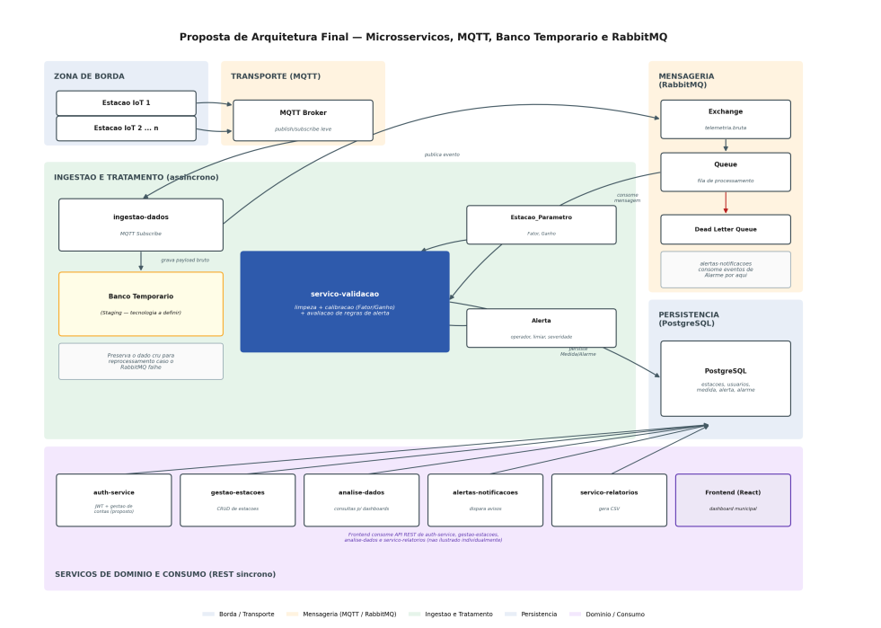
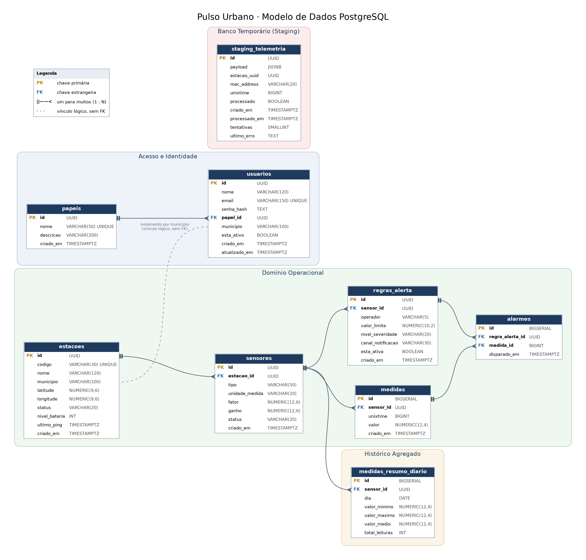
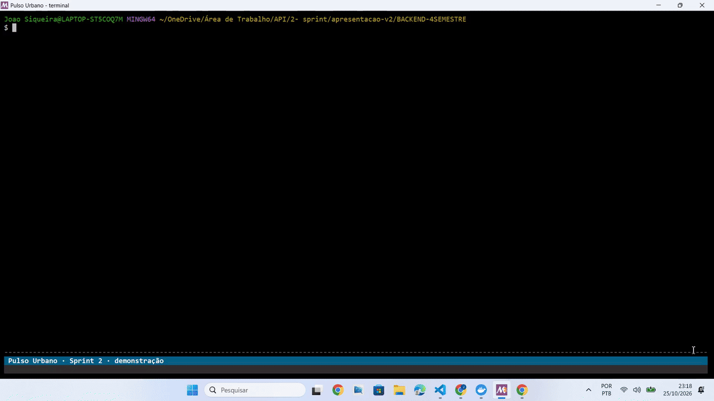

# API DSM - 4º SEMESTRE 2026

<h2 align="center"> ELEMENTARES </h2>

<p align="center">
  <a href="#sobre">Visão Geral</a> |
  <a href="#backlog">Produto</a> |
  <a href="#engenharia">Engenharia e DevOps</a> |
  <a href="#qualidade">Testes e Qualidade</a> |
  <a href="#cronograma">Cronograma</a> |
  <a href="#entregas">Entregas</a> |
  <a href="#manuais">Manuais</a> |
  <a href="#tecnologias">Tecnologias</a> |
  <a href="#equipe">Nossa Equipe</a>
</p>

> **Tema:** Smart Cities 🏙️
>
> **Fase Atual:** Sprint 2 — Recepção de dados de ponta a ponta + alertas e alarmes 🚀

### 🔗 Links Rápidos

| Recurso                                 |                                                  Link                                                  |
| --------------------------------------- | :----------------------------------------------------------------------------------------------------: |
| 📋 Board do Produto (Jira)              | [Acessar Backlog](https://elementares-4sem.atlassian.net/jira/software/projects/ELEM/boards/1/backlog) |
| 🖥️ Repositório Backend               |                [BACKEND-4SEMESTRE](https://github.com/ELEMENTARES-DSM/BACKEND-4SEMESTRE)                |
| 🎨 Repositório Frontend                |               [FRONTEND-4SEMESTRE](https://github.com/ELEMENTARES-DSM/FRONTEND-4SEMESTRE)               |
| 🏗️ Documento de Arquitetura           |                              [`Arquitetura.pdf`](docs/Arquitetura.pdf)                              |
| 🗄️ Modelo de Dados                    |                          [`Modelo_de_Dados.pdf`](docs/Modelo_de_Dados.pdf)                          |
| 🎬 Demonstração das Entregas           |                                   [Ver seção Entregas](#entregas)                                   |
| 📄 Documentação e Artefatos da Sprint |                                           [`/docs`](docs/)                                           |
| 👥 GitHub e LinkedIn do time            |                                   [Ver seção Nossa Equipe](#equipe)                                   |

---

## 🎯 Visão Geral <a id="sobre"></a>

### 🏢 Parceiro de Negócio (Cliente)

**Diogo Branquinho** (Representando a empresa **TECSUS**).

A [Tecsus](https://www.tecsus.com.br/) é uma empresa de tecnologia especializada em soluções inteligentes para o controle e gestão de utilidades (água, energia e gás) em empresas com múltiplas unidades. Com mais de 10 anos de mercado, a Tecsus atua ajudando negócios a obter visibilidade sobre seus consumos, reduzir desperdícios e automatizar processos operacionais com eficiência e inovação. Seu foco está muito alinhado com as práticas de ESG (Ambiental, Social e Governança), buscando sempre uma gestão sustentável e inteligente.

### ⚠️ A Dor

Municípios e consórcios intermunicipais não possuem hoje uma rede acessível de monitoramento ambiental contínuo, o que dificulta identificar variações críticas de qualidade do ar e condições climáticas em tempo hábil. Sem um histórico confiável de temperatura, umidade, vento e concentração de poluentes como o PM2.5, gestores públicos ficam sem uma base de dados estruturada para embasar decisões e agir preventivamente diante de eventos ambientais críticos.

### 🚀 O Desafio

Construir uma plataforma capaz de capturar continuamente dados de estações meteorológicas de baixo custo, processá-los de forma confiável e disponibilizá-los como série histórica estruturada — assegurando isolamento territorial entre municípios do consórcio, controle de acesso por perfil e resiliência na ingestão, de modo que nenhuma leitura de campo seja perdida.

### ✨ A Solução

O **Pulso Urbano** é uma rede de estações de baixo custo que mede continuamente a qualidade do ar e as condições do clima — como temperatura, umidade, vento e chuva. Os dados ficam disponíveis para o usuário em painéis, relatórios e séries históricas, e a plataforma avisa automaticamente quando algum valor ultrapassa um limite considerado preocupante, ajudando a acompanhar as condições ambientais e tomar decisões com base em informação confiável.

---

## 📌 Produto <a id="backlog"></a>

### 🎯 Meta da Sprint 1

Entregar a fundação da plataforma — contas, autenticação, estações e sensores calibrados — com a lógica de **monitoramento de disponibilidade das estações** e de **classificação de qualidade do ar (IQAr)** já implementada e validada por testes automatizados. Esse é o compromisso apresentado ao cliente como **1ª Entrega** do projeto.

### 📋 Backlog do Produto

O backlog segue a classificação de itens definida pelo cliente: **User Stories de negócio** (valor direto ao usuário) e **Itens Técnicos / Infraestrutura** (engenharia habilitadora) convivem na mesma numeração sequencial, cada um com seu ticket rastreável no Jira. A coluna **Rank** reflete a ordem de dependência de implementação, não apenas a ordem numérica.

| Rank |       US       |   Tipo   | Valor de Negócio                                                                                                                                                  | História                                                                                                                                                                                                                                                                                                                | Épico  |   Ticket   |      Requisitos      | Pontos |     Sprint     |
| :--: | :-------------: | :------: | ------------------------------------------------------------------------------------------------------------------------------------------------------------------ | ------------------------------------------------------------------------------------------------------------------------------------------------------------------------------------------------------------------------------------------------------------------------------------------------------------------------ | ------- | :---------: | :------------------: | :----: | :-------------: |
|  1  | **US-01** | Negócio | Sem controle de identidade e papéis, nenhuma outra funcionalidade pode restringir acesso por perfil — é o alicerce de todo o isolamento territorial do produto. | Como administrador, quero gerenciar contas e papéis hierárquicos para controlar o acesso de gestores e pesquisadores na plataforma.                                                                                                                                                                                    | EPIC-01 |   ELEM-6   |     RF-02, RF-08     |   5   |        1        |
|  2  | **US-02** | Negócio | Garante que cada usuário só opere dentro do que seu perfil permite; sem isso, o isolamento territorial da US-01 não é aplicado em tempo de uso.                | Como usuário cadastrado, quero me autenticar com credenciais corporativas e sessão segura para acessar as áreas e dados restritos ao meu perfil.                                                                                                                                                                      | EPIC-01 |   ELEM-11   |        RF-08        |   3   |        1        |
|  3  | **US-03** | Negócio | Sem estação cadastrada não existe fonte de dado nenhuma — é a entidade central de todo o pipeline de coleta.                                                  | Como gestor público, quero cadastrar e gerenciar estações meteorológicas georreferenciadas para manter o inventário territorial sob governança municipal.                                                                                                                                                          | EPIC-02 |   ELEM-16   |     RF-01, RF-02     |   5   |        1        |
|  4  | **US-05** | Negócio | Sem calibração correta, os valores de PM2.5 e temperatura ficam incorretos — inviabiliza a classificação de qualidade do ar prometida na 1ª Entrega.         | Como gestor público, quero parametrizar e calibrar os sensores associados às estações para que as leituras brutas sejam convertidas em grandezas reais.                                                                                                                                                              | EPIC-02 |   ELEM-27   |     RF-01, RF-02     |   5   |        1        |
|  5  | **US-04** | Negócio | Entrega nomeada na 1ª Entrega ao cliente: garante que uma falha de campo seja percebida pela Secretaria antes que vire lacuna nos dados.                          | Como gestor público, quero monitorar a conectividade e disponibilidade das estações para identificar quedas de sinal e falhas operacionais.                                                                                                                                                                           | EPIC-03 |   ELEM-23   |        RF-03        |   8   |        1        |
|  6  | **US-06** | Negócio | É o motor do IQAr: converte leitura calibrada em alerta ambiental acionável — a entrega central do MVP apresentada ao cliente.                                  | Como técnico da Defesa Civil, quero configurar regras de alerta e limiares críticos para disparar avisos preventivos em condições ambientais severas.                                                                                                                                                                | EPIC-03 |   ELEM-32   |     RF-02, RF-05     |   8   |        1        |
|  —  | **US-07** | Técnico | Garante que qualquer avaliador, incluindo o cliente, entenda o estado real do projeto sem depender de explicação verbal.                                         | Como membro da equipe Elementares, quero manter a documentação do projeto centralizada, atualizada e vinculada aos tickets do Jira, para garantir que qualquer integrante ou avaliador externo compreenda o estado real do projeto sem depender de explicação verbal.                                                | EPIC-04 |   ELEM-58   |        RNF-02        |  3\*  | 1-3 (contínuo) |
|  —  | **US-08** | Técnico | Reduz o tempo de setup e evita divergência de ambiente entre máquinas — o custo de não fazer isso aparece como bug em produção depois.                       | Como desenvolvedor da equipe Elementares, quero ter os repositórios organizados com estrutura de pastas padronizada e ambiente de desenvolvimento reproduzível, para garantir que qualquer integrante trabalhe sobre a mesma base técnica, reduzindo divergência de ambiente e tempo de configuração.              | EPIC-04 |   ELEM-59   |        RNF-03        |  3\*  | 1-3 (contínuo) |
|  —  | **US-09** | Técnico | Garante que uma falha de qualidade seja detectada antes de chegar ao usuário final — sustenta a confiabilidade prometida ao cliente.                             | Como responsável por QA da equipe Elementares, quero definir processos de validação de qualidade e monitorar continuamente a saúde da API, do banco de dados e da esteira de integração, para identificar problemas antes que cheguem ao usuário final e garantir critério objetivo de aprovação das entregas. | EPIC-04 |   ELEM-60   |        RNF-05        |  3\*  | 1-3 (contínuo) |
|  —  | **US-10** | Técnico | Garante que nenhuma entrega futura quebre o que já foi validado com o cliente nesta Sprint.                                                                       | Como desenvolvedor da equipe Elementares, quero implementar uma suíte de testes automatizados que cubra a lógica de negócio crítica e a integração entre a API e o banco de dados, para garantir que nenhuma alteração futura quebre funcionalidades já validadas com o cliente em sprints anteriores.          | EPIC-04 |   ELEM-61   |        RNF-03        |  3\*  | 1-3 (contínuo) |
|  7  | **US-11** | Negócio | Função mais crítica apontada pelo cliente: se a ingestão cai, a leitura do período se perde para sempre. | Receber, via MQTT, as leituras publicadas pelas estações, sem alterar o conteúdo recebido. | EPIC-03 | ELEM-73 | RF-03 | 3 | 2 |
|  8  | **US-12** | Negócio | Impede que payload malformado, estação desconhecida ou inativa entre no fluxo. | Validar o payload e a situação da estação antes de seguir no fluxo. | EPIC-03 | ELEM-74 | RF-03 | 3 | 2 |
|  9  | **US-13** | Negócio | Evita leitura repetida quando o broker reentrega a mensagem (QoS 1). | Ignorar mensagens duplicadas (mesma estação e mesmo timestamp). | EPIC-03 | ELEM-75 | RF-03 | 2 | 2 |
|  10  | **US-14** | Negócio | Guarda a leitura bruta antes de qualquer processamento e mantém a estação "Ativa" no painel da US-04. | Gravar a mensagem no staging e atualizar o último sinal da estação. | EPIC-03 | ELEM-76 | RF-03 | 3 | 2 |
|  11  | **US-15** | Negócio | Entrega a leitura ao serviço de validação sem perder mensagem se o RabbitMQ cair. | Publicar o evento em `telemetria.bruta` (a própria US cria exchange, fila e DLQ). | EPIC-03 | ELEM-77 | RF-03 | 5 | 2 |
|  12  | **US-16** | Técnico | Sem a estação física (só na Sprint 3), é a única forma de gerar dados para testar o fluxo e a carga. | Simulador de estações, em container, com taxa de erro configurável. | EPIC-04 | ELEM-78 | RF-03 | 5 | 2 |
|  13  | **US-17** | Negócio | Gera a série histórica calibrada que alimenta alertas, dashboards e relatórios. | Calibrar a leitura e gravar em `medidas`. | EPIC-03 | ELEM-79 | RF-03 | 5 | 2 |
|  14  | **US-18** | Negócio | Evita medida associada ao sensor errado. | Tratar leitura de sensor inexistente (vai para a DLQ) ou inativo (ignorada, com log e contador). | EPIC-03 | ELEM-80 | RF-03 | 2 | 2 |
|  15  | **US-19** | Negócio | Impede que valor fisicamente impossível entre em dashboards, relatórios e alarmes. | Marcar como inválida a medida com valor fisicamente impossível. | EPIC-03 | ELEM-81 | RF-03 | 2 | 2 |
|  16  | **US-20** | Negócio | Cumpre o pedido do cliente de que nenhuma leitura se perca, mesmo com falha do banco. | Tratar falha de gravação e reenviar eventos da DLQ (rota restrita ao administrador). | EPIC-03 | ELEM-82 | RF-03 | 5 | 2 |
|  17  | **US-21** | Técnico | Para provar que a recepção de dados, função mais crítica para o cliente, funciona de ponta a ponta. | Como membro da equipe Elementares, quero um teste contínuo que envie leituras simuladas pelo fluxo completo e confira que nenhuma se perde, para provar que a recepção de dados, função mais crítica para o cliente, funciona de ponta a ponta. | _a definir_ | ELEM-136 | RF-03, RF-18, RF-20, RF-21, RF-22, RF-23, RF-27, RNF-05, RNF-08 | 5 | 2 |
|  18  | **US-22** | Negócio | Para agir antes que a condição se agrave. | Como Gestor Público Municipal, quero que cada medida válida seja comparada às regras ativas do sensor assim que chega, e que um alarme seja registrado quando o limite for ultrapassado, para agir antes que a condição se agrave. | _a definir_ | ELEM-137 | RF-05, RF-17, RF-26, RF-13, RNF-05 | 8 | 2 |
|  19  | **US-23** | Negócio | Para agir sem precisar estar olhando o sistema. | Como Gestor Público Municipal, quero receber um aviso quando um alarme for disparado numa estação do meu município, para agir sem precisar estar olhando o sistema. | _a definir_ | ELEM-138 | RF-05, RF-13, RF-22, RNF-05 | 5 | 2 |
|  20  | **US-24** | Negócio | Para saber de relance o que está acontecendo e onde. | Como Gestor Público Municipal ou Administrador, quero ver os alarmes do meu município numa tela e um indicador de alarmes abertos em todas as páginas, para saber de relance o que está acontecendo e onde. | _a definir_ | ELEM-139 | RF-04, RF-05, RF-13, RNF-01 | 5 | 2 |
|  21  | **US-25** | Técnico | Garante que as entregas da Sprint 2 não quebrem o que já foi validado com o cliente. | Como desenvolvedor da equipe Elementares, quero uma suíte de testes unitários e de integração no backend, para garantir que nenhuma alteração quebre funcionalidades já validadas. | EPIC-04 | ELEM-116 | RF-11, RNF-08 | 5 | 2 |
|  —  | **US-32** | Técnico | — | Como responsável de DevOps pelo Deploy Automático (CD) da equipe Elementares, quero definir processos, estratégias e tecnologias para o deploy contínuo da aplicação em ambientes de produção e desenvolvimento. | _a definir_ | ELEM-130 | RNF-04, RNF-05 | 5 | 2 |
|  —  | **US-33** | Técnico | Para perceber qualquer parada na recepção de dados antes do usuário e agir rápido. | Como Scrum Master responsável pelo monitoramento (DevOps) da equipe Elementares, quero monitorar a saúde dos serviços, do banco, da mensageria e do servidor, para perceber qualquer parada na recepção de dados antes do usuário e agir rápido. | _a definir_ | ELEM-125 | RNF-05, RNF-10, RNF-11 | 5 | 2 |
|  —  | **US-34** | Técnico | Para que nenhum código quebrado chegue à develop. | Como desenvolvedor da equipe Elementares, quero que todo Pull Request passe por uma esteira de integração contínua que valide tipagem, lint, testes e build, para que nenhum código quebrado chegue à develop. | _a definir_ | ELEM-181 | RNF-03, RNF-08 | 5 | 2 |
|  22  | **US-29** | Negócio | Para que ninguém envie dados em nome de uma estação. | Como Gestor Público Municipal, quero que cada estação tenha acesso próprio ao broker e só consiga publicar no seu tópico, para que ninguém envie dados em nome de uma estação. | _a definir_ | ELEM-157 | RF-18 | a definir | 3 |
|  23  | **US-26** | Negócio | Para que a plataforma trabalhe com dados reais em vez de simulados. | Como Gestor Público Municipal, quero que a estação física envie as leituras dos seus sensores a cada 5 minutos, para que a plataforma trabalhe com dados reais em vez de simulados. | _a definir_ | ELEM-154 | RF-03, RF-18, RNF-08 | a definir | 3 |
|  24  | **US-27** | Negócio | Para não perder dados durante quedas de rede ou do servidor. | Como Gestor Público Municipal, quero que a estação guarde as leituras enquanto estiver sem conexão e envie tudo quando a conexão voltar, para não perder dados durante quedas de rede ou do servidor. | _a definir_ | ELEM-155 | RF-03, RNF-05 | a definir | 3 |
|  25  | **US-28** | Negócio | Para que os avisos sejam sempre sobre a situação atual. | Como Gestor Público Municipal, quero que leituras reenviadas horas depois entrem no histórico sem gerar alarme sobre algo que já passou, para que os avisos sejam sempre sobre a situação atual. | _a definir_ | ELEM-156 | RF-05, RNF-05 | a definir | 3 |
|  26  | **US-30** | Negócio | Para colocar a estação em operação sem depender da equipe de desenvolvimento. | Como Gestor Público Municipal, quero um roteiro para instalar, calibrar e testar a estação, para colocá-la em operação sem depender da equipe de desenvolvimento. | _a definir_ | ELEM-158 | RF-03, RF-05 | a definir | 3 |
|  27  | **US-31** | Negócio | Para consultar e analisar os dados ambientais da minha cidade sem precisar de conta. | Como Munícipe, quero acessar e baixar em CSV os dados das medições do meu município, para consultar e analisar os dados ambientais da minha cidade sem precisar de conta. | _a definir_ | ELEM-159 | RF-09, RF-28, RNF-05 | a definir | 3 |
|  28  | **US-35** | Negócio | Para acompanhar tendências e decidir com base em dados. | Como Gestor Público Municipal, quero ver em painéis a série histórica, as últimas leituras e o IQAr de cada estação do meu município, para acompanhar tendências e decidir com base em dados. | _a definir_ | _a criar_ | RF-04, RF-13, RF-15, RF-26, RNF-01, RNF-10 | a definir | 3 |
|  29  | **US-37** | Técnico | Para garantir que uma leitura vira medida, alarme e aviso sem intervenção manual. | Como membro da equipe Elementares, quero que todos os serviços do backend funcionem juntos, da leitura da estação até a consulta na tela, para garantir que uma leitura vira medida, alarme e aviso sem intervenção manual. | _a definir_ | _a criar_ | RF-03, RF-05, RNF-05, RNF-09, RNF-11 | a definir | 3 |
|  30  | **US-36** | Negócio | Para usar o sistema inteiro sem erro nem tela quebrada. | Como usuário da plataforma (Administrador, Gestor Público ou Pesquisador), quero percorrer todas as telas do meu perfil, do login ao logout, com dados reais, para usar o sistema inteiro sem erro nem tela quebrada. | _a definir_ | _a criar_ | RF-08, RF-12, RF-13, RNF-01, RNF-08 | a definir | 3 |
|  31  | **US-38** | Negócio | Para implantar o Pulso Urbano na Prefeitura sem depender da equipe e sem custos inesperados. | Como Gestor Público Municipal, quero receber a documentação de infraestrutura, instalação, licenças e cobertura do sistema, para implantar o Pulso Urbano na Prefeitura sem depender da equipe e sem custos inesperados. | _a definir_ | _a criar_ | RNF-02, RNF-06, RNF-07 | a definir | 3 |

> **Pontos:** US-01 a US-06 somam 34 Story Points, consenso de Planning Poker (sequência de Fibonacci) — medem valor de negócio. \*Os 3 pontos de US-07 a US-10 são uma estimativa nominal de esforço de engenharia **por sprint** em que houver trabalho ativo (setup inicial na Sprint 1, manutenção e verificação nas Sprints 2 e 3), para fins de organização e apontamento de horas — **não fazem parte** do consenso de Planning Poker das histórias de negócio. **Sprint 2 (US-11 a US-25 e US-32 a US-34):** estimadas por nível de dificuldade (sequência de Fibonacci) — 48 pontos nas histórias de negócio e 30 nos itens técnicos (US-16, US-21, US-25, US-32, US-33 e US-34). A US-11 antiga (13 pontos) foi dividida em US-11 a US-24, e as estimativas preliminares antigas deixaram de valer. **Sprint 3 (US-26 a US-31 e US-35 a US-38):** estimativas a definir. **Numeração atual (conforme o Jira):** US-11 a US-16 (ingestão), US-17 a US-20 (validação), US-21 a US-24 (teste de fluxo contínuo e alarmes), US-25 (testes no backend), US-26 a US-31 (estação física e CSV), US-32 a US-34 (deploy automático, monitoramento e CI) e US-35 a US-38 (dashboards, fluxo completo do backend e do frontend e entregáveis de implantação).

**Épicos:** `EPIC-01` Gestão de Acessos e Perfis de Usuários · `EPIC-02` Inventário Territorial de Estações e Sensores · `EPIC-03` Monitoramento Operacional e Gestão de Alertas · `EPIC-04` Engenharia de Plataforma, DevOps e Qualidade (Técnico).

> **Entrega de valor vs. suporte contínuo:** apenas **US-01 a US-06** entregam valor direto ao cliente — são o que ele vê, usa e valida a cada Sprint. **US-07 a US-10 nunca entregam valor de negócio isoladamente**: são qualidade, documentação e infraestrutura de engenharia, mantidas continuamente ao longo das 3 sprints para que as histórias de negócio possam ser entregues de forma confiável.

#### Por que estas 10 entregas estão priorizadas agora

As seis histórias de negócio (US-01 a US-06) formam uma cadeia de dependência única, sem ramificação: contas → autenticação → cadastro de estações → calibração de sensores → monitoramento de disponibilidade → regras de alerta. **Nenhuma pode ser adiada isoladamente** sem quebrar a que vem depois, e juntas elas são, literalmente, o texto da 1ª Entrega já apresentada ao cliente. Os quatro itens técnicos (US-07 a US-10) não entregam valor direto ao usuário final, mas são pré-requisito de qualidade para que as seis anteriores sejam entregues de forma rastreável, testada e reproduzível — por isso correm em paralelo desde o início da Sprint, e não aparecem na sequência (`Rank: —`).

**Por que US-07 a US-10 atravessam as 3 sprints:** diferente das histórias de negócio, que têm um ponto de conclusão claro (a regra foi cadastrada, o alerta dispara), processos de engenharia não "terminam" — documentação, CI, QA e testes precisam ser mantidos e verificados a cada entrega, não só configurados uma vez. Por isso elas aparecem com Sprint `1-3 (contínuo)`: a Sprint 1 cobre a definição e o setup inicial (ferramenta escolhida, processo documentado, pipeline configurado); as Sprints 2 e 3 cobrem a aplicação e a verificação desse processo contra o código novo que entra a cada sprint.

### 🏃 Sprint Backlog — Sprint 1

Recorte operacional do Product Backlog para esta Sprint: o que é **compromisso** firmado com o cliente, quem executa, e como cada item comprova a Definition of Ready.

| Capacidade estimada pela equipe por Sprint                         |                             34 Story Points nas histórias de negócio (consenso de Planning Poker) + 12 pts nominais de suporte técnico                             |
| ------------------------------------------------------------------ | :--------------------------------------------------------------------------------------------------------------------------------------------------------------------: |
| **Meta da Sprint**                                           | US-01 a US-06 — fundação da plataforma, monitoramento de disponibilidade e classificação de qualidade do ar (IQAr), conforme a 1ª Entrega apresentada ao cliente |
| **Previsão da Sprint (extras, sem compromisso de entrega)** |                             Nenhuma — a capacidade de valor da Sprint 1 já está integralmente ocupada pelas seis histórias de negócio                             |

**Entregas de valor da Sprint 1 (US-01 a US-06)**

| Rank | Prioridade | User Story                                                                                                                                                                                                                                                                                                              | Estimativa | Sprint |
| :--: | :--------: | ----------------------------------------------------------------------------------------------------------------------------------------------------------------------------------------------------------------------------------------------------------------------------------------------------------------------- | :--------: | :----: |
|  01  |    Alta    | Como Administrador do Sistema (Governança Municipal / Consórcio), quero cadastrar, listar, associar papéis hierárquicos e inativar logicamente contas de usuários no sistema, para garantir que gestores públicos e pesquisadores acessem estritamente os recursos e dados autorizados sob governança municipal. |     5     |   1   |
|  02  |    Alta    | Como usuário cadastrado (Administrador, Gestor Público ou Pesquisador), quero me autenticar com credenciais institucionais e manter minha sessão ativa de forma segura, para acessar os painéis de monitoramento e as ferramentas restritas ao meu perfil.                                                          |     3     |   1   |
|  03  |    Alta    | Como Gestor Público Municipal, quero cadastrar e gerenciar estações meteorológicas georreferenciadas, para manter o inventário territorial sob governança municipal e habilitar a coleta de dados ambientais.                                                                                                     |     5     |   1   |
|  04  |    Alta    | Como Gestor Público Municipal, quero monitorar a conectividade e disponibilidade das estações, para identificar quedas de sinal e falhas operacionais antes que virem lacuna nos dados.                                                                                                                              |     8     |   1   |
|  05  |    Alta    | Como Gestor Público Municipal, quero parametrizar e calibrar os sensores associados às estações, para que as leituras brutas sejam convertidas com precisão em grandezas reais.                                                                                                                                    |     5     |   1   |
|  06  |    Alta    | Como técnico da Defesa Civil, quero configurar regras de alerta e limiares críticos por sensor, para disparar avisos preventivos automáticos quando condições ambientais severas forem detectadas.                                                                                                                 |     8     |   1   |

### 🔍 Itens de Pesquisa e Débito Técnico (Spikes e Bugs)

Itens concretos identificados durante o planejamento técnico e a revisão de qualidade, registrados aqui para não ficarem apenas mencionados em texto:

|   Código   |     Tipo     | Item                                                                                                                                                | Épico  |   Ticket   |
| :----------: | :-----------: | --------------------------------------------------------------------------------------------------------------------------------------------------- | ------- | :---------: |
|   SPIKE-01   |     Spike     | Viabilidade de um simulador de estações IoT, para testar o pipeline de ingestão sem depender de hardware físico.                                | EPIC-04 | _a criar_ |
|   SPIKE-02   |     Spike     | Definição do payload de telemetria (grandezas enviadas) e do intervalo de envio das estações.                                                   | EPIC-04 | _a criar_ |
| TECH-DEBT-01 | Item Técnico | Unificação de nomenclatura de schema entre a documentação de arquitetura e as especificações de User Story.                                   | EPIC-04 | _a criar_ |
|   BUGS-S1    |      Bug      | Caça-bugs na `develop` em 26/09: 58 achados (0 críticos, 11 urgentes, 17 perigosos, 14 de risco pequeno e 16 avisos), consolidados em 43 tickets com prioridade definida por severidade. | EPIC-04 | _em abertura_ |

> Os itens com ticket "a criar" ou "em abertura" ainda precisam ser registrados formalmente no Jira antes da próxima revisão — esta tabela documenta a existência deles, mas a rastreabilidade completa depende do ticket real.

### 🏃 Sprint Backlog — Sprint 2

A Sprint 2 (05/10 a 25/10) está em andamento. O compromisso com o cliente é a entrega definida por ele no levantamento de requisitos: **recepção de dados de ponta a ponta + alertas e alarmes**. O texto completo de cada User Story está nos PDFs da pasta [`/docs`](docs/) e no [Backlog do Produto](#backlog) acima.

| Capacidade estimada pela equipe por Sprint                         |                                                       78 pontos estimados por nível de dificuldade (Fibonacci): 48 nas histórias de negócio + 30 nos itens técnicos (US-16, US-21, US-25, US-32, US-33 e US-34)                                                       |
| ------------------------------------------------------------------ | :----------------------------------------------------------------------------------------------------------------------------------------------------------------------: |
| **Meta da Sprint**                                           | US-11 a US-25 e US-32 a US-34 — recepção de dados de ponta a ponta (ingestão, validação, calibração e gravação) + alertas e alarmes, conforme resposta do cliente ao levantamento de requisitos |
| **Previsão da Sprint (extras, sem compromisso de entrega)** | Nenhuma                                                                        |

| Rank | Prioridade | US | Ticket | Objetivo | Estimativa |
| :--: | :--------: | :-: | :----: | -------- | :--------: |
|  07  |    Alta    | US-11 | ELEM-73 | Receber leituras das estações via MQTT | 3 |
|  08  |    Alta    | US-12 | ELEM-74 | Validar payload e estação ativa | 3 |
|  09  |    Alta    | US-13 | ELEM-75 | Ignorar leituras duplicadas | 2 |
|  10  |    Alta    | US-14 | ELEM-76 | Gravar no staging e atualizar o último sinal | 3 |
|  11  |    Alta    | US-15 | ELEM-77 | Publicar em `telemetria.bruta` | 5 |
|  12  |    Alta    | US-16 | ELEM-78 | Simulador de estações | 5 |
|  13  |    Alta    | US-17 | ELEM-79 | Calibrar e gravar em `medidas` | 5 |
|  14  |   Média    | US-18 | ELEM-80 | Tratar leituras de sensor inexistente ou inativo | 2 |
|  15  |   Média    | US-19 | ELEM-81 | Marcar como inválido o valor fisicamente impossível | 2 |
|  16  |    Alta    | US-20 | ELEM-82 | Tratar falha de gravação e reenviar eventos da DLQ | 5 |
|  17  |    Alta    | US-21 | ELEM-136 | Teste contínuo ingestão | 5 |
|  18  |    Alta    | US-22 | ELEM-137 | Avaliar regras de alerta e registrar alarme | 8 |
|  19  |    Alta    | US-23 | ELEM-138 | Avisar gestores sobre alarme disparado | 5 |
|  20  |    Alta    | US-24 | ELEM-139 | Tela de alarmes e indicador | 5 |
|  21  |   Média    | US-25 | ELEM-116 | Implementação de testes unitários no backend | 5 |
|  —  |   Média    | US-32 | ELEM-130 | Processo de Deploy Automático | 5 |
|  —  |   Média    | US-33 | ELEM-125 | Monitoramento da infraestrutura e do fluxo de dados | 5 |
|  —  |   Média    | US-34 | ELEM-181 | Integração contínua (CI) | 5 |

**Spikes da Sprint 2:**

|   Código   |     Tipo     | Item | Épico | Ticket |
| :--------: | :----------: | ---- | ----- | :----: |
|  SPIKE-04  |    Spike     | Estudar MQTT, base da recepção de dados das estações (US-11). | EPIC-04 | ELEM-87 |
|  SPIKE-05  |    Spike     | Estudar como simular o envio de dados das estações de forma fiel (US-16). | EPIC-04 | ELEM-88 |

**Comum a todas as US da Sprint 2 (DoR):** testes automatizados da lógica de negócio rodando no CI, sem `--passWithNoTests`; rotas novas ou alteradas documentadas no OpenAPI, com exemplo de requisição e resposta; isolamento territorial testado com dois gestores de municípios diferentes (SJC e SP), quando aplicável; migrations novas seguindo `docs/migrations.md`; manual de instalação atualizado se a US trouxer serviço, variável de ambiente ou passo novo.

> **DoR Verificado:** data e responsável serão registrados por US. Responsáveis ainda não definidos.

### 🏃 Sprint Backlog — Sprint 3

A Sprint 3 (02/11 a 22/11) está planejada. A meta é **entregar a estação física funcionando**: ela lê os sensores a cada 5 minutos, as leituras chegam ao painel e disparam alarme, e nenhuma leitura se perde quando a rede cai. O texto completo de cada User Story está nos PDFs da pasta [`/docs`](docs/) e no [Backlog do Produto](#backlog) acima.

| Capacidade estimada pela equipe por Sprint                         |                                                       A definir                                                       |
| ------------------------------------------------------------------ | :----------------------------------------------------------------------------------------------------------------------------------------------------------------------: |
| **Meta da Sprint**                                           | US-26 a US-31 e US-35 a US-38 — estação física integrada à plataforma (acesso seguro ao broker, envio das leituras, armazenamento sem rede, leitura atrasada sem alarme, instalação e aceite), exportação pública de medições em CSV, dashboards, fluxo completo do backend e do frontend e entregáveis de implantação |
| **Previsão da Sprint (extras, sem compromisso de entrega)** | Nenhuma                                                                        |

| Rank | Prioridade | US | Ticket | Objetivo | Estimativa |
| :--: | :--------: | :-: | :----: | -------- | :--------: |
|  22  |   Média    | US-29 | ELEM-157 | Acesso de cada estação ao broker | a definir |
|  23  |   Média    | US-26 | ELEM-154 | Estação envia as leituras dos sensores | a definir |
|  24  |   Média    | US-27 | ELEM-155 | Estação guarda as leituras quando a rede cai | a definir |
|  25  |   Média    | US-28 | ELEM-156 | Leitura antiga não gera alarme | a definir |
|  26  |   Média    | US-30 | ELEM-158 | Instalar, calibrar e aceitar a estação | a definir |
|  27  |   Baixa    | US-31 | ELEM-159 | Exportar medições em CSV | a definir |
|  28  |   Média    | US-35 | _a criar_ | Dashboards da qualidade do ar e das estações | a definir |
|  29  |   Média    | US-37 | _a criar_ | Fluxo completo do backend | a definir |
|  30  |   Média    | US-36 | _a criar_ | Fluxo completo do frontend | a definir |
|  31  |   Média    | US-38 | _a criar_ | Entregáveis de implantação na Prefeitura | a definir |

**Ordem de execução:** estação física: US-29 → US-26 → US-27 → US-28 → US-30. Plataforma: US-35 → US-37 → US-36. A US-31 e a US-38 não dependem da estação e podem correr em paralelo.

**Pendências para o DoR:** placa e sensores são fornecidos pelo cliente — ao chegarem, conferir se a placa tem Wi-Fi, memória flash e suporte a TLS 1.2 com certificado de cliente (exigido pelo Mosquitto), porque as US-26, US-27 e US-29 contam com isso. Confirmar também o IP fixo do servidor na rede local e se essa rede tem acesso a NTP.

---

### 📋 Requisitos do Sistema

> Os códigos RF/RNF seguem a numeração oficial definida com o cliente. Os RF-11 a RF-27 e os RNF-06 a RNF-14 são sub-requisitos derivados dos originais e das respostas do cliente, conforme as páginas de Requisitos Funcionais e Não Funcionais do Confluence. As descrições abaixo foram detalhadas para refletir como cada requisito se manifesta especificamente na solução Pulso Urbano — não são texto genérico de briefing.

**Requisitos Funcionais (RF):**

* **RF-01 — Modelo de Dados Dinâmico:** o cadastro de sensores aceita qualquer grandeza (temperatura, umidade, PM2.5, vento, pressão) através do campo `grandeza` na tabela `sensores`, sem exigir alteração de schema para adicionar um novo tipo de sensor.
* **RF-02 — CRUD de Estações, Parâmetros, Alertas e Usuários:** criação, listagem, edição e inativação lógica (nunca exclusão física) de estações, sensores, regras de alerta, contas e papéis — preservando o histórico de medições vinculado.
* **RF-03 — Recepção de Dados:** ingestão via protocolo MQTT, com gravação imediata em banco temporário e processamento assíncrono via RabbitMQ, garantindo que uma falha no processamento não descarte a leitura de campo.
* **RF-04 — Dashboards:** painéis exibindo a classificação de qualidade do ar (IQAr) em tempo real e o status de disponibilidade de cada estação (Ativa / Com Falha / Inativa), sempre isolados por município.
* **RF-05 — Geração de Alertas:** disparo automático de evento quando uma leitura calibrada viola o limiar de uma regra ativa, publicado no RabbitMQ e consumido pelo `alertas-notificacoes` — sem depender de consulta periódica ao banco.
* **RF-06 — Datalogger:** módulo embarcado na estação física (Sprint 3) responsável por registrar as leituras brutas dos sensores antes do envio via MQTT.
* **RF-07 — Estação Meteorológica:** construção física da estação de baixo custo com sensores de temperatura, umidade, PM2.5, vento e pressão, integrada ao datalogger.
* **RF-08 — Controle de Acesso:** autenticação via JWT com três perfis (Administrador, Gestor Público, Pesquisador) e isolamento territorial — um Gestor Público só acessa dados do seu próprio município.
* **RF-09 — Relatórios:** exportação em PDF/CSV do histórico de medições e alarmes de um município, para auditoria e acompanhamento pela gestão municipal.
* **RF-10 — Análise Estatística:** aplicação de estatística sobre a série histórica de qualidade do ar e clima, para identificar padrões e tendências ambientais ao longo do tempo.
* **RF-11 — Gestão de Contas de Usuário:** o Administrador cadastra, lista, inativa e reativa contas de usuário, atribuindo um papel (Administrador, Gestor Público ou Pesquisador). O e-mail é único no sistema, o Gestor Público precisa ter município, e a conta inativada perde o acesso sem que o registro seja apagado. _(Deriva de RF-02 e RF-08.)_
* **RF-12 — Autenticação e Sessão:** o usuário entra com e-mail e senha e recebe uma sessão com prazo de validade. Credencial errada recebe uma mensagem que não revela se o e-mail existe, conta inativa é recusada e, sem sessão válida, o usuário volta para o login. _(Deriva de RF-08.)_
* **RF-13 — Autorização por Perfil e Isolamento por Município:** cada função fica disponível só para os perfis autorizados. O Gestor Público vê e altera apenas dados do seu município, e as funções administrativas (gestão de contas, métricas e reenvio de falhas) são exclusivas do Administrador. _(Deriva de RF-08.)_
* **RF-14 — Gestão de Estações:** cadastrar, listar e inativar as estações meteorológicas do município, com código único, nome e coordenadas válidas (latitude e longitude). A estação inativada mantém o histórico de medições. _(Deriva de RF-02.)_
* **RF-15 — Disponibilidade das Estações:** painel por município com a situação de cada estação (Ativa, Com Falha ou Inativa), o total de cada situação e o tempo desde o último sinal. A estação passa a Com Falha depois de 15 minutos sem sinal (3 ciclos de 5 minutos); a estação inativada aparece como Inativa e não conta como falha. _(Deriva de RF-04.)_
* **RF-16 — Gestão de Sensores e Calibração:** cadastrar, listar e inativar os sensores de uma estação, informando grandeza, unidade de medida, fator e ganho de calibração. Qualquer grandeza pode ser cadastrada sem alterar o sistema. _(Deriva de RF-01 e RF-02.)_
* **RF-17 — Gestão de Regras de Alerta:** cadastrar, listar e inativar regras de alerta ligadas a um sensor do município, com operador de comparação (>, >=, <, <=, =), valor limite e severidade. Regra inativa não gera alerta. _(Deriva de RF-02 e RF-05.)_
* **RF-18 — Recebimento das Leituras via MQTT:** o sistema recebe as leituras publicadas por todas as estações via MQTT, identifica a estação pelo tópico e guarda o conteúdo como chegou, com o horário de recebimento. Se a conexão cair, o sistema reconecta sozinho sem perder as leituras publicadas nesse intervalo. _(Deriva de RF-03.)_
* **RF-19 — Validação das Leituras Recebidas:** toda leitura recebida é conferida antes de seguir: formato combinado (horário, lista de leituras e nível de bateria entre 0 e 100) e estação cadastrada e ativa. A leitura recusada é registrada com o motivo, e a recusa de uma leitura não impede as demais. _(Deriva de RF-03.)_
* **RF-20 — Descarte de Leituras Duplicadas:** uma leitura da mesma estação com o mesmo horário é processada uma única vez, mesmo que chegue repetida ou ao mesmo tempo. A repetição é descartada sem ser tratada como erro. _(Deriva de RF-03.)_
* **RF-21 — Gravação Imediata no Banco Temporário:** toda mensagem recebida, aceita ou recusada, é gravada no banco temporário antes de qualquer processamento. A mensagem aceita atualiza o último sinal e o nível de bateria da estação. Se o banco temporário falhar, a mensagem não é descartada. _(Deriva de RF-03.)_
* **RF-22 — Encaminhamento Assíncrono sem Perda:** as leituras gravadas seguem para processamento por fila, sem que a recepção espere o processamento terminar. Se a fila estiver fora do ar, as leituras ficam pendentes e são reenviadas automaticamente, na ordem de chegada, quando ela voltar. _(Deriva de RF-03.)_
* **RF-23 — Simulação de Estações:** um simulador publica leituras no mesmo formato e pelo mesmo canal da estação física, com quantidade de estações, intervalo de envio e tipos de defeito configuráveis. _(Deriva de RF-03 e RF-07.)_
* **RF-24 — Calibração e Gravação das Medidas:** cada leitura válida é convertida em valor real pela fórmula (valor bruto × fator) + ganho do sensor, sem erro de arredondamento, e gravada com o horário da estação. A mesma medida nunca é gravada duas vezes, e as leituras de uma mensagem são gravadas juntas ou nenhuma é gravada. _(Deriva de RF-01 e RF-03.)_
* **RF-25 — Leituras de Sensor Inexistente ou Inativo:** a leitura de um sensor que não existe vai para a fila de falhas com o motivo. A leitura de um sensor inativado é descartada e contabilizada. As demais leituras da mesma mensagem seguem normalmente. _(Deriva de RF-03.)_
* **RF-26 — Medidas Fisicamente Impossíveis:** uma medida fora da faixa física possível da grandeza (por exemplo, umidade acima de 100%) é gravada marcada como inválida e não entra em dashboards, relatórios, análises nem alertas. _(Deriva de RF-03.)_
* **RF-27 — Reprocessamento de Falhas:** se o banco de dados estiver indisponível, nenhuma leitura é perdida: o processamento espera e retoma. A leitura que falha repetidas vezes vai para a fila de falhas, e o Administrador pode reenviá-la depois de corrigir a causa. _(Deriva de RF-03.)_

**Requisitos Não Funcionais (RNF):**

* **RNF-01 — Experiência do Usuário (UX):** interface com Dark Mode exibindo badges de severidade (Informativo/Alerta/Crítico) e status de estação de forma visualmente imediata, sem exigir leitura de texto para identificar risco.
* **RNF-02 — Documentação de APIs:** rotas documentadas com exemplo de requisição e resposta, priorizadas conforme o cliente definiu: manual de instalação, rotas da API, modelo de dados, arquitetura e manual do usuário, nesta ordem.
* **RNF-03 — Integração Contínua (CI):** esteira no GitHub Actions com validação de tipos TypeScript, lint e suíte de testes, bloqueando merge em caso de falha — branches `main` e `develop` dos repositórios de código protegidas por *ruleset*.
* **RNF-04 — Deploy Automatizado (CD):** entrega contínua para homologação e produção, acionada após aprovação de Pull Request.
* **RNF-05 — Robustez e Escalabilidade:** suporte a picos de acesso simultâneo, especialmente no momento em que um alerta crítico é disparado — quando a consulta ao Portal Público tende a aumentar repentinamente. A recepção de dados (ingestão) é a função mais crítica do sistema: uma falha no dashboard é reversível consultando depois, uma falha na ingestão perde a leitura daquele período para sempre.
* **RNF-06 — Instalação Reproduzível em Máquina Limpa:** qualquer pessoa consegue instalar e executar o sistema completo do zero, numa máquina limpa, seguindo um procedimento documentado, com o ambiente em contêineres e versões fixas, sem instalar dependências manualmente. _(Deriva de RNF-02.)_
* **RNF-07 — Custo e Transferência de Tecnologia:** (requisito organizacional) o projeto documenta o custo de implantação e de operação (equipe, infraestrutura e estação) para comprovar a viabilidade de baixo custo e permitir a transferência da tecnologia. _(Deriva de RNF-02.)_
* **RNF-08 — Qualidade Verificada por Testes:** a lógica de negócio crítica tem testes automatizados executados na integração contínua, com cobertura mínima de 70% (meta do time), e os critérios de aceitação são conferidos antes de concluir cada item. _(Deriva de RNF-03.)_
* **RNF-09 — Arquitetura de Serviços Independentes:** cada responsabilidade (autenticação, gestão de estações, recepção, validação, alertas e relatórios) roda em um serviço próprio. Os serviços se comunicam por API REST ou por fila, e o frontend acessa os dados só pela API. A queda de um serviço de consulta não interrompe a recepção de dados. _(Deriva de RNF-05.)_
* **RNF-10 — Capacidade:** o sistema suporta uma leitura por estação a cada 5 minutos, para todas as estações cadastradas, e 50 usuários simultâneos, com as consultas do painel respondendo em menos de 200 ms (meta do time). _(Deriva de RNF-05.)_
* **RNF-11 — Observabilidade do Fluxo de Dados:** os serviços informam a sua saúde (conexão com broker, fila e banco) e os contadores do fluxo (recebidas, recusadas por motivo, duplicadas, pendentes, inválidas e na fila de falhas), consultáveis apenas pelo Administrador. _(Deriva de RNF-05.)_
* **RNF-12 — Segurança de Credenciais:** senhas são guardadas apenas como hash; o token de sessão é assinado e tem validade; segredos (chave do token, senhas de banco e do broker) ficam fora do código e do repositório; cada estação e serviço precisa de credencial própria para publicar ou ler no broker. _(Deriva de RF-08.)_
* **RNF-13 — Retenção dos Dados:** as medidas são mantidas enquanto o projeto existir, sem expurgo automático. Cadastros (usuários, estações, sensores e regras) nunca são excluídos fisicamente, apenas inativados. Só o banco temporário é limpo, e somente depois de a leitura estar confirmada no banco definitivo.
* **RNF-14 — Rastreabilidade do Requisito ao Código:** (requisito organizacional) todo item do backlog no Jira tem prioridade, responsável, estimativa, critérios de aceitação e requisito associado, e todo commit e Pull Request cita a chave do item no Jira.

---

### 📐 Variáveis Monitoradas

O escopo de sensores do MVP foi definido a partir da dor do cliente: cada variável coletada existe porque ajuda a caracterizar as condições ambientais e a qualidade do ar do município.

| Variável             | Unidade | Por que está no escopo                                                                                                             |
| --------------------- | :-----: | ----------------------------------------------------------------------------------------------------------------------------------- |
| Temperatura           |   °C   | Variável mais diretamente observável para identificar diferenças térmicas entre regiões (ilhas de calor).                      |
| Umidade Relativa      |    %    | Interfere nas trocas de energia da atmosfera e caracteriza condições de baixa umidade, relevantes para a dispersão de poluentes. |
| PM2.5                 | µg/m³ | Partícula fina em suspensão, um dos principais indicadores de qualidade do ar em áreas urbanas.                                  |
| Velocidade do Vento   |  km/h  | Determina o transporte e a dispersão dos poluentes a partir da fonte.                                                              |
| Direção do Vento    |   °   | Indica de onde vem o poluente e quais áreas tendem a ser afetadas.                                                                 |
| Precipitação        |   mm   | Influencia a remoção de material particulado suspenso na atmosfera.                                                               |
| Pressão Atmosférica |   hPa   | Condiciona a estagnação ou dispersão do ar próximo à superfície.                                                              |

> **Fora do escopo do MVP:** PM10, O₃, NO₂, CO₂, radiação solar/UV, variáveis de solo e de nuvens. São variáveis válidas em meteorologia, mas não contribuem diretamente para a análise proposta nesta fase.

---

### 🎯 Critérios de Aceite (DoR e DoD) <a id="dor-dod"></a>

**Definition of Ready (DoR):**

* User Story escrita no padrão ágil (**Como / Quero / Para**).
* Critérios de aceitação definidos no formato BDD (**Dado / Quando / Então**).
* Requisitos Funcionais e Não Funcionais associados e mapeados no Confluence.
* Dicionário de dados da entidade validado com tipos SQL e TypeScript.
* Sem dependências bloqueadoras para o início do desenvolvimento.

**Definition of Done (DoD):**

* Código implementado segundo os padrões arquiteturais do repositório.
* Subtarefas do Jira finalizadas e horas de esforço apontadas no card pai.
* Cobertura de testes unitários/integração validando os cenários da história.
* Pull Request revisado e aprovado por pelo menos um membro do Dev Team (**peer review**).
* Documentação de API atualizada e rastreabilidade amarrada no Jira e Confluence.
* Entrega homologada formalmente pelo Product Owner na coluna **Validação PO**.

---

## ⚙️ Engenharia e DevOps <a id="engenharia"></a>

As práticas técnicas da equipe Elementares unem o desenvolvimento de software (Dev) à infraestrutura e qualidade (Ops) com transparência, visando entregas incrementais e rastreáveis.

## 📐 Arquitetura



A plataforma adota uma arquitetura de microsserviços organizada em dois fluxos: um fluxo assíncrono de ingestão e tratamento de telemetria e um fluxo síncrono de serviços de domínio expostos via API REST.

No fluxo de ingestão, as estações IoT publicam a telemetria bruta em um broker MQTT. O serviço de ingestão assina esses tópicos, grava o payload original em um banco temporário (staging) e publica o evento no RabbitMQ. O serviço de validação consome a fila, aplica a calibração de cada estação (fator e ganho), avalia as regras de alerta e persiste o dado tratado no PostgreSQL. Mensagens que falham repetidamente são desviadas para uma Dead Letter Queue, e os eventos de alarme são consumidos pelo serviço de alertas e notificações.

Esse desacoplamento garante que uma falha no processamento nunca interrompa a coleta em campo: o dado bruto permanece preservado no banco temporário e pode ser reprocessado, sendo republicado no RabbitMQ.

Os serviços de domínio (autenticação, gestão de estações, análise de dados, alertas e relatórios) acessam o PostgreSQL e expõem APIs REST consumidas pelo frontend em React, que oferece o dashboard municipal.

> O caminho completo de uma leitura e o racional de cada decisão arquitetural estão no documento [Arquitetura do Sistema](docs/Arquitetura.pdf).

| Microsserviço           | Responsabilidade                                                       |
| ------------------------ | ---------------------------------------------------------------------- |
| `auth-service`         | Autenticação e emissão de token de sessão.                         |
| `gestao-usuarios`      | CRUD de contas, papéis e vínculo municipal.                          |
| `gestao-estacoes`      | CRUD de estações, sensores e regras de alerta.                       |
| `ingestao-dados`       | Recepção da telemetria via MQTT e escrita no banco temporário.      |
| `servico-validacao`    | Limpeza, calibração (Fator/Ganho) e avaliação de regras de alerta. |
| `analise-dados`        | Consultas agregadas para dashboards e relatórios.                     |
| `alertas-notificacoes` | Disparo de avisos quando um limiar é violado.                         |
| `servico-relatorios`   | Geração assíncrona de arquivos de exportação.                     |

**Stack técnica:**

* **Backend:** Node.js com TypeScript e Express, estruturado em camadas (Controllers, Services, Repositories, Middlewares).
* **Frontend:** SPA em React (Vite) com TypeScript, estilizado com Tailwind CSS e DaisyUI.
* **Banco de Dados:** PostgreSQL acessado diretamente via biblioteca cliente `pg`, com integridade referencial estrita, índices analíticos e exclusão lógica (*soft delete*). Redis e PostgreSQL compõem o banco temporário (staging) da ingestão.
* **Mensageria:** MQTT na borda (dispositivos) e RabbitMQ na comunicação entre microsserviços, com Dead Letter Queue para tratamento de falhas.
* **Segurança:** Autenticação stateless via Token JWT (HMAC-SHA256) e senhas criptografadas com `bcryptjs` (salt rounds 10).

### 🗄️ Modelo de Dados



O modelo relacional do PostgreSQL tem 9 tabelas, organizadas em quatro blocos: acesso e identidade, domínio operacional, banco temporário (staging) e histórico agregado. O papel de cada tabela, coluna, índice e rotina está explicado no documento [Modelo de Dados](docs/Modelo_de_Dados.pdf).

### 🚀 Pipeline de Entrega (CI/CD)

1. **Planejamento:** PO e Dev Team refinam requisitos no Confluence e organizam tarefas no Jira.
2. **Desenvolvimento:** Criação de branches a partir da `develop`, associadas ao ticket.
3. **Qualidade e CI:** GitHub Actions executa validação de tipos TypeScript, lint e testes automatizados a cada Pull Request.
4. **Code Review:** Pull Requests exigem aprovação de pelo menos um par antes do merge.
5. **Deploy:** Entrega contínua para homologação e produção após aprovação.

### 🔀 Padrão de Versionamento e Commits

A rastreabilidade entre o código no GitHub e os cartões do Jira é mandatória.

**Fluxo de trabalho:** `feature/*` → `develop` → `main`

Os repositórios de código (backend e frontend) estão configurados para aceitar **exclusivamente squash merge**, e a mensagem do commit é gerada a partir do **título do Pull Request**. Por isso, o título do PR deve seguir o padrão do squad — é ele que chega na `develop`.

```bash
# Formato do título do PR e do commit:
ELEM-XX tipo: Título resumido da alteração

# Exemplo de feature:
git commit -m "ELEM-6 feat: Implementado endpoint de listagem de usuarios" -m "Criada rota GET /usuarios com suporte a paginacao e filtro de status ativo."

# Exceções de documentação e manutenção (sem ticket vinculado):
git commit -m "docs: Atualizado README com o Backlog do Produto da Sprint 1"
git commit -m "chore: Ajustada configuracao de dependencias do package.json"
```

**Tipos aceitos:** `feat`, `fix`, `docs`, `test`, `refactor`, `chore`, `style`.

**Nomenclatura de branches:**

| Tipo           | Padrão                                 |
| -------------- | --------------------------------------- |
| Funcionalidade | `feat/ELEM-XX-nome-da-funcionalidade` |
| Correção     | `fix/ELEM-XX-descricao-do-ajuste`     |
| Documentação | `docs/ELEM-XX-atualizacao-documento`  |

### 🛡️ Governança do Repositório

Nos repositórios **BACKEND-4SEMESTRE** e **FRONTEND-4SEMESTRE**, as branches `main` e `develop` são protegidas por *ruleset*, exigindo:

* Pull Request aprovado por pelo menos um revisor antes do merge;
* Aprovação nos checks automatizados da esteira de CI;
* Bloqueio de *force push* e de deleção de branch.

---

## 🛡️ Testes e Qualidade <a id="qualidade"></a>

A estratégia de garantia de qualidade contempla:

* **Ferramentas:** [Vitest](https://vitest.dev/) no frontend, reaproveitando a configuração já existente do Vite, e [Jest](https://jestjs.io/) nos microsserviços do backend.
* **Testes de Unidade:** Validação da lógica de negócio crítica — conversão de leituras (equação afim), avaliação de regras de alerta e validação de dados de entrada.
* **Testes de Integração:** Validação da comunicação entre a API e o banco de dados em ambiente controlado por containers.
* **Testes de API:** Validação de contratos HTTP, status codes (200, 201, 400, 401, 403, 409) e payloads.
* **Rastreabilidade de Testes:** Cada User Story possui uma tarefa de teste consolidada no Jira contendo o checklist de casos executados.
* **Execução Automatizada:** A suíte é executada a cada Pull Request e bloqueia o merge em caso de falha.
* **Backend (US-25, Sprint 2):** testes unitários da lógica de negócio sem acessar banco, fila ou rede; testes de integração das rotas, no caso de sucesso e em cada erro previsto, com PostgreSQL real em container (só RabbitMQ, Redis e MQTT podem ser simulados); cada teste parte de um banco limpo; isolamento por município testado; cobertura mínima de 70% sobre a lógica de negócio, reportada no pipeline e verificada no PR.

---

## 📅 Cronograma de Entregas <a id="cronograma"></a>

| Sprint             | Período      | Objetivo Principal                                                                                                                   | Status          |
| ------------------ | ------------- | ------------------------------------------------------------------------------------------------------------------------------------ | --------------- |
| **Sprint 1** | 07/09 a 27/09 | **MVP 1:** Governança de Usuários, Autenticação, Gestão de Estações, Monitoramento de Conectividade e Regras de Alerta. | ✅ Encerrada |
| **Sprint 2** | 05/10 a 25/10 | **MVP 2:** Recepção de dados de ponta a ponta (ingestão, validação, calibração e gravação) + alertas e alarmes.          | ⏳ Em andamento    |
| **Sprint 3** | 02/11 a 22/11 | **MVP 3:** Estação física funcionando: lê os sensores a cada 5 minutos, as leituras chegam ao painel e disparam alarme, e nenhuma leitura se perde quando a rede cai. | ⏳ Planejado    |

---

## 🎬 Entregas por Sprint <a id="entregas"></a>

<details>
<summary><b>Sprint 1</b> — MVP 1: Governança de Usuários, Autenticação, Gestão de Estações, Monitoramento de Conectividade e Regras de Alerta</summary>

<br>


</details>

<details open>
<summary><b>Sprint 2</b> — MVP 2: Recepção de dados de ponta a ponta (ingestão, validação, calibração e gravação) + alertas e alarmes</summary>

<br>



</details>

<details>
<summary><b>Sprint 3</b> — MVP 3</summary>

<br>

_Em breve._

</details>

---

## 💻 Guias e Manuais <a id="manuais"></a>

### 📂 Estrutura deste Repositório

```
API-4SEMESTRE/
├── backend/    → submódulo do BACKEND-4SEMESTRE
├── frontend/   → submódulo do FRONTEND-4SEMESTRE
├── assets/     → materiais de entrega por sprint (demonstrações)
├── docs/       → documentação do produto (arquitetura e manuais)
└── README.md
```

> Os submódulos apontam para um commit específico de cada repositório. O desenvolvimento acontece diretamente no **BACKEND-4SEMESTRE** e no **FRONTEND-4SEMESTRE**; os ponteiros deste repositório são atualizados ao final de cada sprint.

### 📄 Documentos

| Documento              | Link                                    | Situação       |
| ---------------------- | --------------------------------------- | -------------- |
| Arquitetura do Sistema | [`Arquitetura.pdf`](docs/Arquitetura.pdf) | ✅ Publicado    |
| Modelo de Dados        | [`Modelo_de_Dados.pdf`](docs/Modelo_de_Dados.pdf) | ✅ Publicado    |
| Manual de Instalação   | —                                       | 🔄 Em validação |
| Manual do Usuário      | —                                       | ⏳ A elaborar   |

### Pré-requisitos

* Git
* Docker e Docker Compose
* Node.js 22 ou superior e npm

### Execução Local (Resumo)

```bash
# 1. Clonar o repositório com os submódulos
git clone --recurse-submodules https://github.com/ELEMENTARES-DSM/API-4SEMESTRE.git
cd API-4SEMESTRE

# 2. Backend: configurar variáveis (o .env.example vem vazio; preencha antes de subir)
cd backend
cp .env.example .env

# 3. Subir os containers (PostgreSQL, Redis, RabbitMQ e microsserviços)
docker compose up -d

# 4. Migrations, por serviço e nesta ordem
for svc in gestao-usuarios gestao-estacoes alertas-notificacoes; do
  (cd services/$svc && npm ci && npm run migrate -- up)
done

# 5. Frontend (deixe VITE_API_URL vazio no .env para usar o proxy do Vite)
cd ../frontend
cp .env.example .env
npm install
npm run dev
# Aplicação em http://localhost:5173
```

> O passo a passo completo, com as variáveis de ambiente e a solução de problemas comuns, estará no **Manual de Instalação**, atualmente em validação.

> O projeto também disponibiliza configuração de **DevContainer**, permitindo abrir o ambiente já padronizado diretamente no VS Code, sem configuração manual.

---

## 🛠️ Tecnologias <a id="tecnologias"></a>

| Camada                   | Tecnologias                                            |
| ------------------------ | ------------------------------------------------------ |
| **Frontend**       | React · Vite · TypeScript · Tailwind CSS · DaisyUI |
| **Backend**        | Node.js · TypeScript · Express · biblioteca `pg`   |
| **Banco de Dados** | PostgreSQL · Redis (staging)                           |
| **Mensageria**     | MQTT · RabbitMQ                                       |
| **Testes**         | Vitest (frontend) · Jest (backend)                     |
| **Infraestrutura** | Docker · Docker Compose · DevContainers              |
| **CI/CD**          | GitHub Actions · GitHub Rulesets                      |
| **Gestão**        | Jira · Confluence                                     |

---

## 🤝 Nossa Equipe <a id="equipe"></a>

| Nome | Scrum | DevOps | Redes Sociais |
| :--- | :--- | :--- | :--- |
| *João Moura* | Scrum Master | Monitoramento | [](https://github.com/JoaooMoura) [](https://www.linkedin.com/in/joaoomoura/) |
| *Lucas Inácio* | Product Owner (PO) | Testes Unitários | [](https://github.com/Lukitta013) [](https://www.linkedin.com/in/luucasinacioo/) |
| *João Vitor Siqueira* | DevTeam | Rastreabilidade de Requisitos | [](https://github.com/kakashinho) [](https://www.linkedin.com/in/joao-vitor-siqueira-a2a2a3227/) |
| *Enzo Gabriel de Paula* | DevTeam | Documentação (Docs) | [](https://github.com/EnzoGabrielCode) [](https://www.linkedin.com/in/enzo-gabriel-de-paula-8795a8332/) |
| *Ana Graciano* | DevTeam | QA (Garantia da Qualidade) | [](https://github.com/Ane-Graciano) [](https://www.linkedin.com/in/ana-graciano/) |
| *Gustavo Rosa* | DevTeam | Deploy Automático (CD) | [](https://github.com/gustasvos) [](https://www.linkedin.com/in/gustavo-rosa-46a251180/) |
| *Laís Zanardi* | DevTeam | Continuous Integration (CI) | [](https://github.com/lais-zanardi) [](https://www.linkedin.com/in/lais-zanardi-inocencio/) |
| *Pedro Nascimento* | DevTeam | Testes de Integração | [](https://github.com/P3dr0213) [](https://www.linkedin.com/in/pedro-nascimento-87a22937a/) |