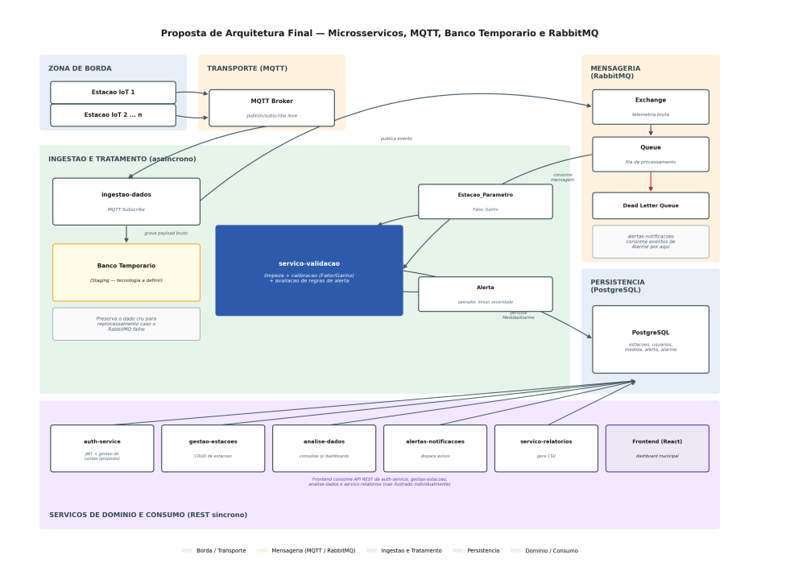
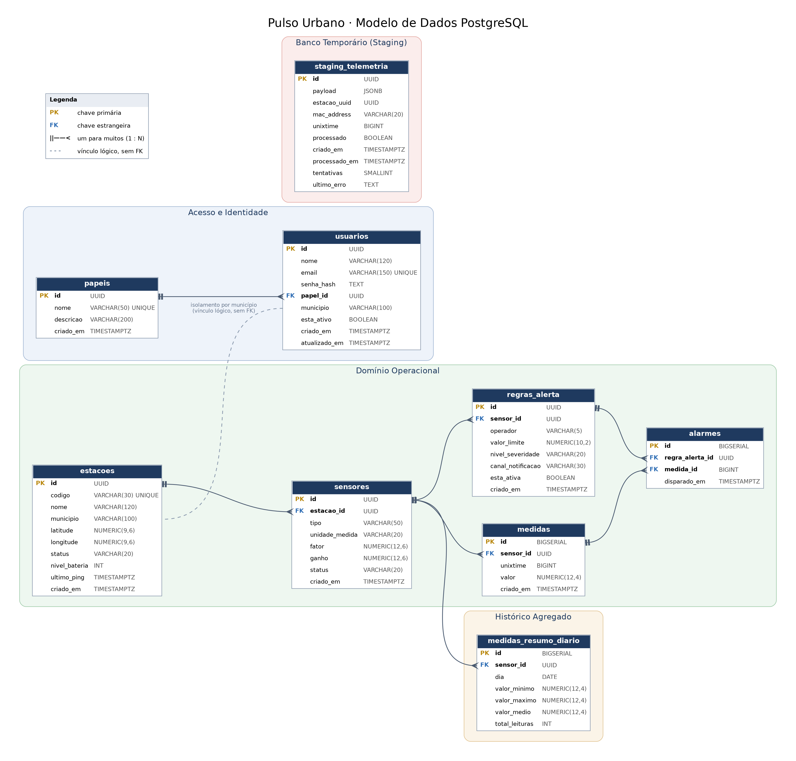

<a href="../README.md">🏠 Início</a> · <a href="backlog.md">Backlog</a> · <a href="sprints/sprint-1.md">Sprint 1</a> · <a href="sprints/sprint-2.md">Sprint 2</a> · <a href="sprints/sprint-3.md">Sprint 3</a> · <a href="requisitos.md">Requisitos</a> · <b>Arquitetura</b> · <a href="processo.md">Processo</a> · <a href="qualidade.md">Qualidade</a> · <a href="instalacao.md">Instalação</a>

# 📐 Arquitetura

A plataforma adota uma arquitetura de microsserviços organizada em dois fluxos: um fluxo assíncrono de ingestão e tratamento de telemetria e um fluxo síncrono de serviços de domínio expostos via API REST.

No fluxo de ingestão, as estações IoT publicam a telemetria bruta em um broker MQTT. O serviço de ingestão assina esses tópicos e **grava a mensagem bruta no banco temporário (Valkey)** antes de qualquer verificação. Em seguida, publica o evento no RabbitMQ, na ordem de chegada. O serviço de validação consome a fila, aplica as regras e validações, a calibração de cada sensor (fator e ganho) e as regras de alerta, e grava o dado tratado no **PostgreSQL**, onde nada é apagado. Mensagens que falham repetidamente são desviadas para uma Dead Letter Queue, e os eventos de alarme são consumidos pelo serviço de alertas e notificações.

Esse desacoplamento garante que uma falha no processamento nunca interrompa a coleta em campo: se o RabbitMQ cair, a leitura espera no Valkey e é publicada quando ele volta; se o PostgreSQL cair, ela espera na fila durável. O banco temporário é limpo 7 dias depois de a leitura ser entregue à fila.

Os serviços de domínio (autenticação, gestão de usuários e estações, análise de dados, alertas e relatórios) acessam o PostgreSQL e expõem APIs REST consumidas pelo frontend em React, que oferece o dashboard municipal e o painel público.

> O caminho completo de uma leitura e o racional de cada decisão arquitetural estão no documento [Arquitetura do Sistema](Arquitetura.pdf).

| Microsserviço           | Responsabilidade                                                       |
| ------------------------ | ---------------------------------------------------------------------- |
| `auth-service`         | Autenticação e emissão de token de sessão.                         |
| `gestao-usuarios`      | CRUD de contas, papéis, vínculo municipal e cadastro do munícipe.     |
| `gestao-estacoes`      | CRUD de estações, sensores, regras de alerta e catálogo de grandezas. |
| `ingestao-dados`       | Recepção da telemetria via MQTT e gravação no banco temporário (Valkey). |
| `servico-validacao`    | Regras e validações, calibração (Fator/Ganho) e avaliação de regras de alerta. |
| `analise-dados`        | Consultas agregadas para dashboards e para a API pública.             |
| `alertas-notificacoes` | Disparo de avisos quando um limiar é violado.                         |
| `servico-relatorios`   | Geração diária dos arquivos CSV de exportação.                     |

**Stack técnica:**

* **Backend:** Node.js com TypeScript e Express, estruturado em camadas (Controllers, Services, Repositories, Middlewares).
* **Frontend:** SPA em React (Vite) com TypeScript, estilizado com Tailwind CSS e DaisyUI.
* **Banco de Dados:** PostgreSQL acessado diretamente via biblioteca cliente `pg`, com integridade referencial estrita, índices analíticos e exclusão lógica (*soft delete*); guarda o dado tratado, sem expurgo. **Valkey** (open source, licença BSD, no lugar do Redis) é o banco temporário (staging) da ingestão e guarda os tokens revogados e as cotas da API pública.
* **Mensageria:** MQTT na borda (dispositivos) e RabbitMQ na comunicação entre microsserviços, com Dead Letter Queue para tratamento de falhas.
* **Segurança:** Autenticação stateless via Token JWT (HMAC-SHA256) e senhas criptografadas com `bcryptjs` (salt rounds 10).

### 🖥️ Implantação na Prefeitura

O sistema roda na infraestrutura física da Prefeitura, sem nuvem e só com software open source, em 4 servidores:

| Servidor | O que roda | Acesso externo |
| --- | --- | --- |
| **S1 · Aplicação** | nginx, frontend, auth-service, gestao-usuarios, gestao-estacoes, analise-dados, servico-relatorios e Valkey (sessões e cotas) | HTTPS (443) |
| **S2 · Recepção** | Mosquitto, ingestao-dados, Valkey (staging), RabbitMQ, servico-validacao e alertas-notificacoes | MQTT com TLS (8883) |
| **S3 · Banco** | PostgreSQL | Nenhum |
| **S4 · Backup e monitoramento** | Cópias do banco, Prometheus e Grafana | Só VPN |

A configuração de cada servidor (CPU, memória, disco e rede) está em revisão na task 38.03. O monitoramento avisa quando CPU passa de 50%, memória de 80% ou disco de 60%, os limites pedidos pelo cliente.

**Quem responde por quê:** a Prefeitura é a dona dos dados e da infraestrutura física e de rede; a Tecsus licencia o sistema, opera os servidores e faz a triagem técnica (suporte nível 2); a Elementares corrige bugs e faz melhorias durante o pacote de manutenção de 6 meses (nível 3). O munícipe fala com a ouvidoria da Prefeitura, nunca direto com a equipe.

### 🗄️ Modelo de Dados

O modelo relacional do PostgreSQL está organizado em quatro blocos: acesso e identidade, domínio operacional, banco temporário (staging) e histórico agregado. O papel de cada tabela, coluna, índice e rotina está explicado no documento [Modelo de Dados](Modelo_de_Dados.pdf). Com a US-40, o staging passa para o Valkey e a tabela `staging_telemetria` deixa de receber gravações.

---

<a href="requisitos.md">← Requisitos</a> | <a href="processo.md">Processo →</a>

