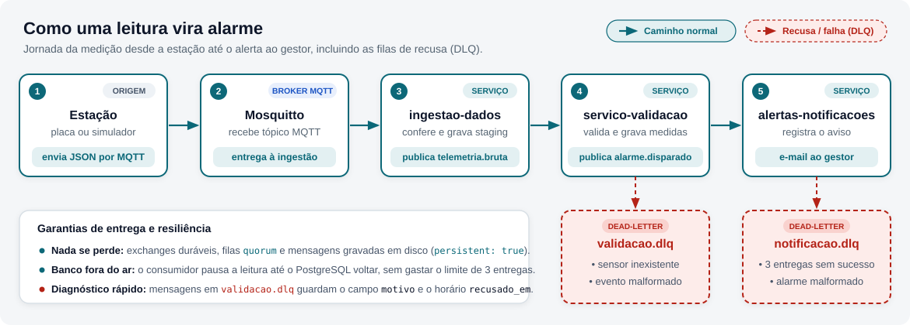
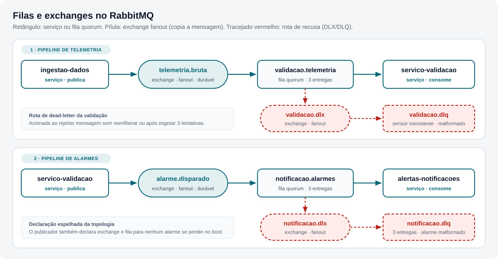
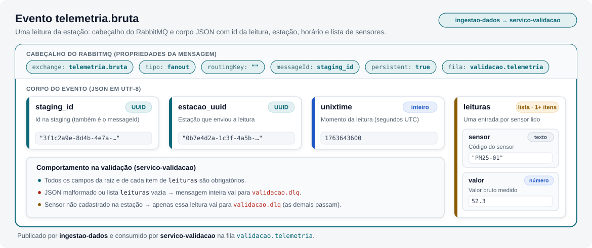
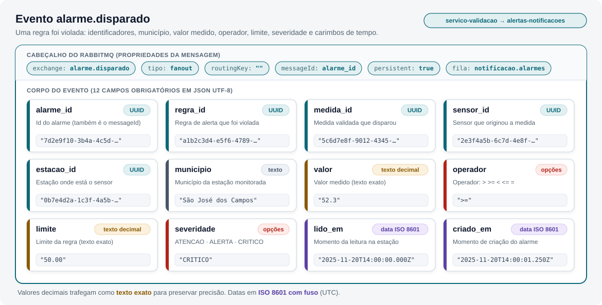
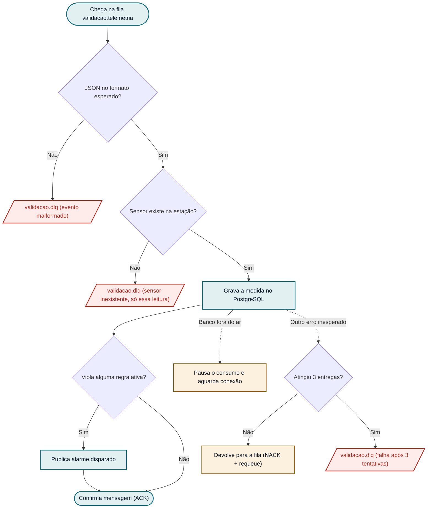

<p align="center">
<a href="../README.md">🏠 Início</a> · <a href="backlog.md">Backlog</a> · <a href="sprints/sprint-1.md">Sprint 1</a> · <a href="sprints/sprint-2.md">Sprint 2</a> · <a href="sprints/sprint-3.md">Sprint 3</a> · <a href="requisitos.md">Requisitos</a> · <a href="arquitetura.md">Arquitetura</a> · <b>Eventos</b> · <a href="processo.md">Processo</a> · <a href="qualidade.md">Qualidade</a> · <a href="instalacao.md">Instalação</a>
</p>

# Eventos do Backend

Como uma leitura da estação vira um alarme, por quais filas ela passa e o que acontece quando uma mensagem é recusada.

**Navegação rápida:**
[1. Visão geral](#1-o-caminho-de-uma-leitura) · [2. Topologia RabbitMQ](#2-onde-cada-mensagem-fica) · [3. `telemetria.bruta`](#3-evento-telemetriabruta) · [4. `alarme.disparado`](#4-evento-alarmedisparado) · [5. Tratamento de falhas e DLQ](#5-quando-uma-mensagem-não-passa) · [6. Como testar no painel](#6-testar-pelo-painel-do-rabbitmq)

---

## Resumo dos eventos

| Evento (Exchange) | Publicador | Fila de consumo | Consumidor | Fila de recusa (DLQ) | Identificador (`messageId`) |
| --- | --- | --- | --- | --- | --- |
| [`telemetria.bruta`](#3-evento-telemetriabruta) | `ingestao-dados` | `validacao.telemetria` | `servico-validacao` | `validacao.dlq` | `staging_id` |
| [`alarme.disparado`](#4-evento-alarmedisparado) | `servico-validacao` | `notificacao.alarmes` | `alertas-notificacoes` | `notificacao.dlq` | `alarme_id` |

---

## 1. O caminho de uma leitura



---

## 2. Onde cada mensagem fica



<details>
<summary><b>Detalhes técnicos: configuração dos exchanges, filas e mensagens</b></summary>

| Parâmetro | Configuração padrão | Observação |
| --- | --- | --- |
| **Exchange** | `fanout`, durável (`durable: true`) | `routingKey` vazia (`""`) |
| **Fila de consumo** | `quorum`, `x-delivery-limit: 3` | Reentrega até 3 vezes antes de enviar à DLX |
| **Persistência** | `persistent: true` (`deliveryMode: 2`) | Mensagens sobrevivem a reinícios do broker |
| **Codificação** | JSON em `UTF-8` (`application/json`) | Todos os campos documentados são obrigatórios |
| **Valores decimais** | Texto exato (`"52.3"`, `"50.00"`) em `alarme.disparado` | Evita perda de precisão de ponto flutuante |

> [!NOTE]
> O publicador de `alarme.disparado` (`servico-validacao`) também declara a topologia completa ao subir. Assim, nenhum alarme se perde caso o `alertas-notificacoes` ainda não tenha iniciado.

</details>

---

## 3. Evento `telemetria.bruta`

Publicado pelo serviço **`ingestao-dados`** após gravar o pacote na staging e consumido pelo **`servico-validacao`** na fila `validacao.telemetria`.



<details>
<summary><b>Tabela de campos e exemplo de payload JSON</b></summary>

| Campo | Tipo | Obrigatório | Descrição |
| --- | --- | :---: | --- |
| `staging_id` | `UUID` | Sim | Identificador da leitura na staging. Também é enviado como `messageId` no cabeçalho do RabbitMQ. |
| `estacao_uuid` | `UUID` | Sim | Identificador da estação que enviou a leitura. |
| `unixtime` | `inteiro` | Sim | Momento da leitura na estação, em segundos desde `1970-01-01T00:00:00Z` (UTC). |
| `leituras` | `lista` | Sim (1+) | Lista de medições do pacote (ao menos 1 entrada). |
| `leituras[].sensor` | `texto` | Sim | Código do sensor cadastrado na estação (ex.: `PM25-01`). |
| `leituras[].valor` | `número` | Sim | Valor bruto medido pelo sensor. |

```json
{
  "staging_id": "3f1c2a9e-8d4b-4e7a-9b1e-2c5d6f7a8b90",
  "estacao_uuid": "0b7e4d2a-1c3f-4a5b-8d6e-9f0a1b2c3d4e",
  "unixtime": 1763643600,
  "leituras": [
    { "sensor": "PM25-01", "valor": 52.3 },
    { "sensor": "TEMP-01", "valor": 24.8 }
  ]
}
```

</details>

---

## 4. Evento `alarme.disparado`

Publicado pelo **`servico-validacao`** sempre que uma medida validada viola uma regra ativa. Consumido pelo **`alertas-notificacoes`** na fila `notificacao.alarmes`.



<details>
<summary><b>Tabela de campos e exemplo de payload JSON</b></summary>

| Campo | Tipo | Obrigatório | Descrição |
| --- | --- | :---: | --- |
| `alarme_id` | `UUID` | Sim | Identificador do alarme. Também é enviado como `messageId` no cabeçalho do RabbitMQ. |
| `regra_id` | `UUID` | Sim | Identificador da regra de alerta violada. |
| `medida_id` | `UUID` | Sim | Identificador da medida que disparou o alarme. |
| `sensor_id` | `UUID` | Sim | Identificador do sensor da medida. |
| `estacao_id` | `UUID` | Sim | Identificador da estação onde está o sensor. |
| `municipio` | `texto` | Sim | Município da estação monitorada. |
| `valor` | `texto decimal` | Sim | Valor medido convertido em texto exato (ex.: `"52.3"`). |
| `operador` | `texto` | Sim | Operador da regra violada: `>`, `>=`, `<`, `<=` ou `=`. |
| `limite` | `texto decimal` | Sim | Limite configurado na regra em texto exato (ex.: `"50.00"`). |
| `severidade` | `texto` | Sim | Nível de criticidade: `ATENCAO`, `ALERTA` ou `CRITICO`. |
| `lido_em` | `data ISO 8601` | Sim | Momento da leitura na estação com fuso horário (UTC). |
| `criado_em` | `data ISO 8601` | Sim | Momento em que o alarme foi gravado com fuso horário (UTC). |

```json
{
  "alarme_id": "7d2e9f10-3b4a-4c5d-9e6f-1a2b3c4d5e6f",
  "regra_id": "a1b2c3d4-e5f6-4789-8abc-def012345678",
  "medida_id": "5c6d7e8f-9012-4345-a678-9bcdef012345",
  "sensor_id": "2e3f4a5b-6c7d-4e8f-9a0b-1c2d3e4f5a6b",
  "estacao_id": "0b7e4d2a-1c3f-4a5b-8d6e-9f0a1b2c3d4e",
  "municipio": "São José dos Campos",
  "valor": "52.3",
  "operador": ">=",
  "limite": "50.00",
  "severidade": "CRITICO",
  "lido_em": "2025-11-20T14:00:00.000Z",
  "criado_em": "2025-11-20T14:00:01.250Z"
}
```

</details>

---

## 5. Quando uma mensagem não passa

Nenhuma mensagem desaparece silenciosamente. Cada falha tem um destino determinístico:



### Guia rápido de diagnóstico (Troubleshooting)

| Sintoma observado | Causa provável | O que fazer |
| --- | --- | --- |
| Mensagem em `validacao.dlq` com `"Evento malformado"` | JSON inválido ou campo obrigatório ausente | Compare o payload com o exemplo da seção 3 e corrija o emissor. Ela não volta sozinha. |
| Mensagem em `validacao.dlq` com `"Sensor inexistente"` | Código do sensor não está cadastrado na estação | Cadastre o sensor na estação correspondente e reenvie pela rota de reprocessamento da DLQ. |
| Mensagem em `notificacao.dlq` | Alarme malformado ou falha no envio do aviso por 3 vezes | Consulte os logs do `alertas-notificacoes` filtrando pelo `messageId` (`alarme_id`). |
| Fila acumula mensagens e não anda | Banco de dados fora do ar (o consumidor pausa de propósito) | Restaure o PostgreSQL. O consumidor retoma a leitura sozinho sem perder mensagens. |
| Alarme gravado no banco, mas o e-mail não chegou | Falha no provedor de e-mail após 3 tentativas | Verifique a mensagem em `notificacao.dlq`. O registro do alarme permanece salvo no banco. |

---

## 6. Testar pelo painel do RabbitMQ

> [!TIP]
> Você pode publicar eventos manualmente pelo painel de gerenciamento do RabbitMQ para validar o fluxo ponta a ponta localmente.

1. **Suba o broker:**
   ```bash
   docker compose up -d rabbitmq
   ```
2. **Acesse o painel web:** abra **http://localhost:15672** e entre com `RABBITMQ_USER` e `RABBITMQ_PASSWORD` definidos no `.env`.
3. **Publique o evento:** na aba **Exchanges**, clique em `telemetria.bruta` e abra a seção **Publish message** (mantenha `Routing key` vazia).
4. **Envie o payload:** cole o JSON de exemplo da [seção 3](#3-evento-telemetriabruta) no campo **Payload** e clique em **Publish message**.
5. **Verifique o resultado:** na aba **Queues**, a fila `validacao.telemetria` deve processar e esvaziar. Caso a mensagem caia em `validacao.dlq`, inspecione o payload com **Get messages**: o campo `motivo` indica exatamente a razão da recusa.

*(Para testar `alarme.disparado`, repita o mesmo procedimento publicando no exchange `alarme.disparado` com o JSON da [seção 4](#4-evento-alarmedisparado)).*

---

<p align="center"><a href="arquitetura.md">← Arquitetura</a> | <a href="processo.md">Processo →</a></p>
