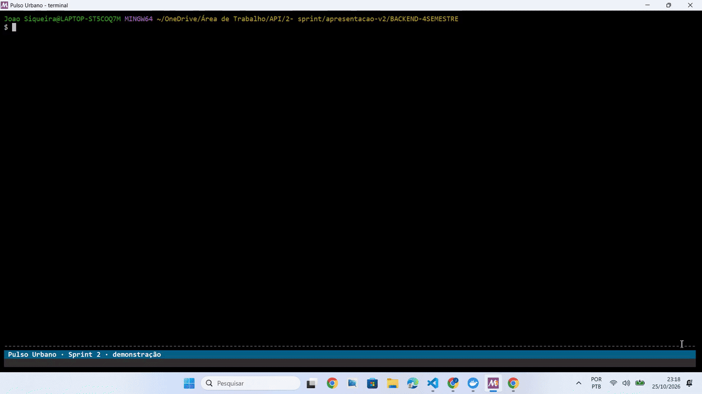

<a href="../../README.md">🏠 Início</a> · <a href="../backlog.md">Backlog</a> · <a href="sprint-1.md">Sprint 1</a> · <b>Sprint 2</b> · <a href="sprint-3.md">Sprint 3</a> · <a href="../requisitos.md">Requisitos</a> · <a href="../arquitetura.md">Arquitetura</a> · <a href="../processo.md">Processo</a> · <a href="../qualidade.md">Qualidade</a> · <a href="../instalacao.md">Instalação</a>

# 🏃 Sprint 2 · 05/10 a 25/10 ✅

**MVP 2:** Recepção de dados de ponta a ponta (ingestão, validação, calibração e gravação) + alertas e alarmes. Encerrada em 26/10.

O compromisso com o cliente foi a entrega definida por ele no levantamento de requisitos: **recepção de dados de ponta a ponta + alertas e alarmes**.

| Capacidade estimada pela equipe | 58 pontos (Fibonacci): 48 nas histórias de negócio + 10 nos itens técnicos (US-16 e US-21). Os itens de DevOps ficaram sem estimativa |
| --- | :--: |
| **Meta da Sprint** | US-11 a US-25, US-32 e US-33 — recepção de dados de ponta a ponta (ingestão, validação, calibração e gravação) + alertas e alarmes |
| **Previsão (extras, sem compromisso)** | Nenhuma |

| Ordem | Prioridade | US | Ticket | Objetivo | Estimativa |
| :--: | :--: | :--: | :--: | --- | :--: |
| 1 | Média | US-11 | ELEM-73 | Receber leituras das estações via MQTT | 3 |
| 2 | Média | US-12 | ELEM-74 | Validar payload e estação ativa | 3 |
| 3 | Média | US-13 | ELEM-75 | Ignorar leituras duplicadas | 2 |
| 4 | Média | US-14 | ELEM-76 | Gravar no staging e atualizar o último sinal | 3 |
| 5 | Média | US-15 | ELEM-77 | Publicar em `telemetria.bruta` | 5 |
| 6 | Média | US-17 | ELEM-79 | Calibrar e gravar em `medidas` | 5 |
| 7 | Média | US-18 | ELEM-80 | Tratar leituras de sensor inexistente ou inativo | 2 |
| 8 | Média | US-19 | ELEM-81 | Marcar como inválido o valor fisicamente impossível | 2 |
| 9 | Média | US-20 | ELEM-82 | Tratar falha de gravação e reenviar eventos da DLQ | 5 |
| 10 | Média | US-22 | ELEM-137 | Avaliar regras de alerta e registrar alarme | 8 |
| 11 | Média | US-23 | ELEM-138 | Avisar gestores sobre alarme disparado | 5 |
| 12 | Média | US-24 | ELEM-139 | Tela de alarmes e indicador | 5 |

**Plataforma, DevOps e Qualidade iniciados nesta sprint** (a US-25, a US-32 e a US-33 continuam na Sprint 3):

| Ordem | Prioridade | US | Ticket | Objetivo | Estimativa |
| :--: | :--: | :--: | :--: | --- | :--: |
| 1 | Média | US-16 | ELEM-78 | Simulador de estações | 5 |
| 2 | Média | US-21 | ELEM-136 | Teste contínuo da ingestão | 5 |
| 3 | Média | US-25 | ELEM-116 | Testes unitários no backend | — |
| 4 | Média | US-32 | ELEM-130 | Processo de deploy automático | — |
| 5 | Média | US-33 | ELEM-125 | Monitoramento da infraestrutura e do fluxo de dados | — |

**Comum a todas as US da Sprint 2 (DoR):** testes automatizados da lógica de negócio rodando no CI, sem `--passWithNoTests`; rotas novas ou alteradas documentadas no OpenAPI, com exemplo de requisição e resposta; isolamento territorial testado com dois gestores de municípios diferentes (SJC e SP), quando aplicável; migrations novas seguindo `docs/migrations.md`; manual de instalação atualizado se a US trouxer serviço, variável de ambiente ou passo novo.

### 🎬 Demonstração

---

<a href="sprint-1.md">← Sprint 1</a> | <a href="sprint-3.md">Sprint 3 →</a>

